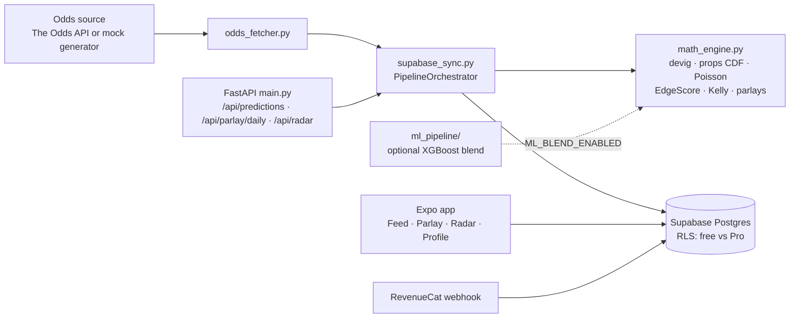

# EdgePoint+

**A sports-analytics probability engine (FastAPI + Python) with an Expo/React Native app. It strips bookmaker margin, models true probabilities for basketball props and football markets, and flags positive-expected-value (+EV) picks with an EdgeScore.**

> **Status:** prototype. The pipeline runs end-to-end in mock mode (`MOCK_MODE=True`). The live-odds adapter is a known gap, documented and pinned by a test (see [Honest limitations](#honest-limitations)). No public deployment is live right now.

---

## The problem

Bookmaker odds have a built-in margin (the "vig"), so the implied probabilities on a betting slip never reflect the true chance of an outcome. EdgePoint+ removes that margin, builds its own probability for each market, and compares the two. Only picks where the model sees a measurable edge are surfaced, each with a fractional-Kelly stake recommendation, and Pro-tier picks are gated behind a subscription.

## Key features

- **Vig stripping**: proportional (multiplicative) and power (Shin-style) devigging to recover fair odds (`backend/math_engine.py`).
- **Basketball player props**: rolling-form weighting (0.50·L3 + 0.30·L5 + 0.20·L10), opponent-defence and pace adjustments, and a continuity-corrected normal CDF for points, rebounds, assists and PRA lines.
- **Football markets**: a Poisson score matrix (up to 9×9) for over/under totals and both-teams-to-score.
- **EdgeScore (0–100) and EdgeDelta (Δ = model output − sportsbook line)**, with EV % per pick.
- **Fractional Kelly staking**: ¼ Kelly by default, capped at 3.0 units (configurable).
- **PointBlank parlays**: a curated daily multi-leg slip, plus a custom parlay builder in the app that computes combined odds, win probability and EV.
- **EdgeRadar**: line-movement and steam tracking between sharp and retail books.
- **Subscriptions**: RevenueCat entitlements synced into Supabase, with Pro picks gated by row-level security.
- **ML research pipeline** (off by default): historical football data ingestion, rolling features, an XGBoost model with walk-forward validation, and a flat-bet ROI simulation (`backend/ml_pipeline/`, `backend/historical_data/`).

## Tech stack

| Layer | Tools |
| --- | --- |
| Engine / API | Python, FastAPI, Uvicorn, Pydantic v2, NumPy, SciPy, httpx |
| ML research | pandas, scikit-learn, XGBoost, joblib |
| Database & auth | Supabase (Postgres, RLS, RPC for RevenueCat webhooks) |
| Mobile / web | Expo 51, React Native 0.74, Expo Router, TypeScript, Zustand, react-native-web |
| Payments | RevenueCat (`react-native-purchases`) |
| Tests | pytest |

## Architecture



```
EdgePoint-/
├── backend/        # Python engine, FastAPI server, CLI daemon, ML pipeline, pytest suite
├── supabase/       # migrations (schema, RLS, RevenueCat webhook, denormalized fields) + seed data
└── mobile/         # Expo / React Native app (iOS, Android, web)
```

## Notable engineering decisions

Each item below is backed by code in this repo.

- **Model outputs are stored as `NUMERIC`, never float.** Odds, probabilities, EV % and EdgeScore columns are fixed-precision, and `edge_score` has a `CHECK (0–100)` constraint (`supabase/migrations/20260905_01_init_schema.sql`).
- **Row-level security gates paid content in the database, not just the UI.** Free predictions and parlays are public. Pro rows are visible only when `is_active_subscriber()` is true, which also honours RevenueCat's billing-issue grace period (`20260905_02_rls_policies.sql`).
- **Pro data in the API needs an internal key.** Once `INTERNAL_API_KEY` is set, Pro-tier responses require a matching `X-API-Key` header.
- **ML stays switched off until it's proven.** `ML_BLEND_ENABLED=False` by default. Training uses walk-forward (season-by-season) splits rather than a random split, and the betting simulation warns when there are too few bets to mean anything.
- **Polite data fetching.** Historical CSV downloads run one at a time, with a bounded retry that honours the server's `Retry-After` header.
- **Known gaps are pinned in tests.** `tests/test_known_gaps.py` documents and asserts current limitations so they can't be forgotten silently.

## Running locally

### Backend

```bash
cd backend
python -m venv venv && source venv/bin/activate   # Windows: .\venv\Scripts\Activate.ps1
pip install -r requirements.txt
cp .env.example .env                              # MOCK_MODE=True works with no API keys

python main.py --run-once                 # one pipeline run, prints a summary
python main.py --daemon --interval 15     # poll every 15 minutes
python main.py --server --port 8000       # REST API, docs at http://localhost:8000/docs
```

API endpoints: `GET /health`, `GET /api/predictions` (filters `sport`, `tier`, `min_edge_score`), `GET /api/parlay/daily`, `GET /api/radar`, `POST /api/run-pipeline`.

Backend environment variables (`backend/.env.example`): `ENVIRONMENT`, `DEBUG`, `MOCK_MODE`, `POLL_INTERVAL_MINUTES`, `SUPABASE_URL`, `SUPABASE_KEY`, `THE_ODDS_API_KEY`, `API_FOOTBALL_KEY`, `MIN_EV_PERCENTAGE`, `MIN_EDGE_SCORE`, `KELLY_FRACTION`, `MAX_RECOMMENDED_UNITS`, `FREE_TIER_DAILY_PICKS`, `ALLOWED_ORIGINS`, `INTERNAL_API_KEY`, `ML_BLEND_ENABLED`, `ML_BLEND_WEIGHT`.

### Mobile app

```bash
cd mobile
npm install
npx expo start            # add --ios, --android or --web
npm run build:web         # static web export to dist/
```

Optional `mobile/.env`: `EXPO_PUBLIC_SUPABASE_URL`, `EXPO_PUBLIC_SUPABASE_ANON_KEY`, `EXPO_PUBLIC_REVENUECAT_APPLE_KEY`, `EXPO_PUBLIC_REVENUECAT_GOOGLE_KEY`. Without them, the app falls back to bundled mock datasets.

### Database

Run the files in `supabase/migrations/` in order (`01_init_schema`, `02_rls_policies`, `03_revenuecat_webhook`, `04_denormalize_display_fields`), then optionally `supabase/seed_mock_data.sql`. You can also use `supabase db push`. See `supabase/README.md` for the RevenueCat webhook setup.

## Tests

```bash
cd backend && pytest tests/ -v
```

The backend has 121 pytest tests. They cover the math engine, models, config, odds fetcher, Supabase sync, the FastAPI routes, the historical-data pipeline, the market classifier, the backtest, the betting simulation and walk-forward training. All 121 passed in a local run in October 2026. The mobile app has no automated tests yet.

## Honest limitations

- In real (non-mock) mode, `odds_fetcher.py` returns raw Odds-API payloads that the pipeline doesn't map yet, so it produces zero predictions. `test_known_gaps.py` pins this behaviour.
- The ML blend hasn't been validated on real out-of-sample data, which is why it's disabled by default.
- This is analytics software, not financial advice. No win-rate or ROI figures are claimed.

## Project history

4 commits, September 2026 (from `git log`).

---

**Role:** built by **Sanni-Musa Emmanuel George**, full-stack developer and designer, Lagos.
[github.com/geosan11](https://github.com/geosan11) · [linkedin.com/in/george-sanni-musa-92b699195](https://www.linkedin.com/in/george-sanni-musa-92b699195)
