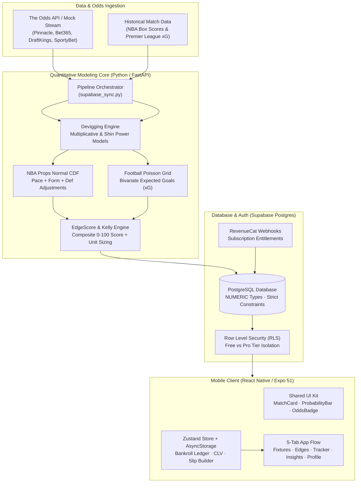

# EdgePoint+ ⚡

**A quantitative sports betting analytics terminal and probability engine (FastAPI + Python + SciPy) paired with an Expo / React Native mobile application. It strips bookmaker margins (vig), projects true probabilities for NBA player props and Premier League football markets, and surfaces positive expected value (+EV) picks with an objective EdgeScore.**

---

## Table of Contents

- [Overview & The Quantitative Problem](#overview--the-quantitative-problem)
- [Key Features](#key-features)
- [Architecture](#architecture)
- [Mathematical & Modeling Engine](#mathematical--modeling-engine)
  - [1. Devigging Algorithms (Vig Stripping)](#1-devigging-algorithms-vig-stripping)
  - [2. NBA Player Prop Projections](#2-nba-player-prop-projections)
  - [3. Football (Soccer) Bivariate Poisson Model](#3-football-soccer-bivariate-poisson-model)
  - [4. EdgeScore (0–100) & EdgeDelta (Δ)](#4-edgescore-0100--edgedelta-δ)
  - [5. Fractional Kelly Criterion Unit Staking](#5-fractional-kelly-criterion-unit-staking)
  - [6. Closing Line Value (CLV) Analytics](#6-closing-line-value-clv-analytics)
- [Mobile Application Suite](#mobile-application-suite)
  - [Tab 1: Fixtures & Odds Comparison Matrix](#tab-1-fixtures--odds-comparison-matrix)
  - [Tab 2: Edges (+EV Value Terminal)](#tab-2-edges-ev-value-terminal)
  - [Tab 3: Tracker & Bankroll Ledger](#tab-3-tracker--bankroll-ledger)
  - [Tab 4: Insights, Steam Radar & Devigging Engine](#tab-4-insights-steam-radar--devigging-engine)
  - [Tab 5: Profile & Bankroll Parameters](#tab-5-profile--bankroll-parameters)
- [Design System & Anti-Slop UI Guidelines](#design-system--anti-slop-ui-guidelines)
- [Tech Stack](#tech-stack)
- [Repository Structure](#repository-structure)
- [Installation & Local Setup](#installation--local-setup)
  - [Backend Setup](#backend-setup)
  - [Mobile App Setup](#mobile-app-setup)
  - [Database & Migrations](#database--migrations)
- [Test Suite & Verification](#test-suite--verification)
- [Honest Limitations & Disclosures](#honest-limitations--disclosures)
- [Author & Credits](#author--credits)

---

## Overview & The Quantitative Problem

Sportsbooks do not offer fair odds. Every market carries an embedded commercial margin known as the **"vig"** or **overround** (typically between 4% and 9%), meaning the sum of implied probabilities on a betting market exceeds 100%:

$$\sum_{k=1}^{n} \frac{1}{\text{Decimal Odds}_k} > 1.0$$

Because of this built-in vig, casual bettors consistently place wagers at negative expected value (-EV). 

**EdgePoint+** is engineered to eliminate this asymmetric bookmaker advantage:
1. It ingests market lines across sharp market makers (e.g., **Pinnacle**) and retail sportsbooks (e.g., **Bet365**, **DraftKings**, **SportyBet**).
2. It strips out the margin using **Multiplicative** and **Power (Shin-style)** devigging algorithms to recover the true underlying market probabilities.
3. It computes independent, pace-adjusted Poisson and continuity-corrected Normal CDF distributions for active **NBA** and **Premier League** slates.
4. It identifies pricing discrepancies where the market odds exceed the zero-vig fair line, recommending calculated unit stakes via the **Fractional Kelly Criterion**.

> **Design Philosophy**: No "Lock of the Day", no speculative get-rich gimmicks, and no hyperbole. EdgePoint+ communicates strictly in calculated probabilities, model edge percentages, closing line value (CLV), and risk-managed unit sizing.

---

## Key Features

- **Multi-Method Vig Stripping**: Recovers fair odds via Multiplicative (proportional) and Power/Shin algorithms (`backend/math_engine.py` & in-app interactive calculator).
- **NBA Player Prop Projections**: Rolling-form decay weighting ($0.50 \cdot L3 + 0.30 \cdot L5 + 0.20 \cdot L10$), opponent defensive rankings, pace multipliers, and continuity-corrected Gaussian CDFs for Points, Rebounds, Assists, and PRA combo lines.
- **Premier League Football Engine**: Bivariate Poisson score matrix ($9 \times 9$) computing true probabilities for Match Totals (Over/Under 2.5), Both Teams to Score (BTTS), and Clean Sheets from team expected goals (xG).
- **Composite EdgeScore (0–100)**: Multi-factor confidence index combining raw EV %, win probability delta, sample size reliability, and sportsbook line discrepancy.
- **Closing Line Value (CLV) Tracking**: Monitors whether placed wagers beat the sharp closing market price—the gold standard metric of long-term betting skill.
- **Sharp Steam Radar**: Live radar flagging line movement velocity across market makers (Pinnacle) and highlighting lagging retail lines with a 1-tap `+ Add Lagging Line to Slip` action.
- **Cross-League Synergy Parlays (PointBlank)**: Curated daily anchor slips paired with a custom parlay builder that recalculates joint decimal odds, joint probability, and fractional Kelly recommendation.
- **Dual Currency & Bankroll Management**: Native support for **NGN (₦)** and **USD ($)** with interactive bankroll sizing, customizable Kelly fractions (1/4, 1/2, Full), and one-tap bet outcome settlement (`WON` / `LOST`).
- **Strict Anti-Slop UI Architecture**: Monochromatic dark canvas (`#000000`, `#111827`, `#1F2937`) paired strictly with **Electric Emerald (`#00E599`)**, Inter typography with tabular figures (`fontVariant: ['tabular-nums']`), and guaranteed $\ge 44$px touch targets.

---

## Architecture



---

## Mathematical & Modeling Engine

### 1. Devigging Algorithms (Vig Stripping)

Given European decimal odds for $n$ mutually exclusive outcomes $O_1, O_2, \dots, O_n$, the total market implied probability $S$ includes the bookmaker margin:

$$S = \sum_{i=1}^{n} \frac{1}{O_i} > 1.0, \quad \text{Vigorish \%} = \left(1 - \frac{1}{S}\right) \times 100$$

EdgePoint+ implements two distinct vig-removal formulations in `backend/math_engine.py`:

#### A. Proportional / Multiplicative Devig
Normalizes raw implied probabilities proportionally to sum to $1.0$:

$$p_i = \frac{1 / O_i}{S}, \quad \text{Fair Odds}_i = \frac{1}{p_i}$$

#### B. Power / Shin Method
Recognizes that bookmakers apply proportionally higher margin to longer shots (the favourite-longshot bias). It solves for exponent $k$ using Brent's root-finding method (`scipy.optimize.brentq`):

$$\sum_{i=1}^{n} \left(\frac{1}{O_i}\right)^k = 1.0 \implies p_i = \left(\frac{1}{O_i}\right)^k$$

---

### 2. NBA Player Prop Projections

For player props (Points, Rebounds, Assists, PRA), projected performance is modeled using a decay-weighted rolling baseline combined with pace and matchup multipliers:

$$\mu_{\text{projected}} = \left(0.50 \cdot \bar{X}_{L3} + 0.30 \cdot \bar{X}_{L5} + 0.20 \cdot \bar{X}_{L10}\right) \times \left(\frac{\text{Game Pace}}{100.0}\right) \times \left(1.0 + \frac{\text{Def Rank} - 15}{15} \times 0.15\right)$$

Because box-score counts are discrete integers, EdgePoint+ applies a **continuity correction of $+0.5$** to the standard Gaussian cumulative distribution function:

$$P(X > \text{line}) = 1 - \Phi\left(\frac{\text{line} + 0.5 - \mu_{\text{projected}}}{\sigma}\right)$$

$$P(X < \text{line}) = \Phi\left(\frac{\text{line} - 0.5 - \mu_{\text{projected}}}{\sigma}\right)$$

---

### 3. Football (Soccer) Bivariate Poisson Model

For match totals and BTTS, goal-scoring expectancies for Home ($\lambda$) and Away ($\mu$) are derived from expected goals (xG) metrics and home-pitch advantage. A bivariate discrete probability matrix (up to $9 \times 9$) is computed:

$$P(\text{Home} = x, \text{Away} = y) = \frac{\lambda^x e^{-\lambda}}{x!} \times \frac{\mu^y e^{-\mu}}{y!}$$

From this joint distribution grid:
- **Over 2.5 Goals**: $\sum_{x+y > 2.5} P(x, y)$
- **Both Teams to Score (BTTS - Yes)**: $\sum_{x \ge 1, y \ge 1} P(x, y) = (1 - e^{-\lambda})(1 - e^{-\mu})$

---

### 4. EdgeScore (0–100) & EdgeDelta (Δ)

To rank picks by true mathematical conviction rather than raw volatility:

- **EdgeDelta ($\Delta$)**: The absolute unit difference between model projected stat and sportsbook line:
  $$\Delta = \mu_{\text{projected}} - \text{Sportsbook Line}$$
- **Expected Value (EV %)**:
  $$\text{EV \%} = \left(p_{\text{model}} \cdot \text{Odds}_{\text{sportsbook}} - 1\right) \times 100$$
- **EdgeScore (0–100)**: A composite score constrained by database `CHECK (edge_score >= 0 AND edge_score <= 100)`:
  $$\text{EdgeScore} = \min\left(100, \max\left(0, 50 + (\text{EV \%} \times 2.0) + (p_{\text{model}} - p_{\text{implied}}) \times 50\right)\right)$$

---

### 5. Fractional Kelly Criterion Unit Staking

To prevent bankroll ruin while capitalizing on positive edge, EdgePoint+ computes sizing using the fractional Kelly formula:

$$f^* = \frac{p \cdot b - q}{b}$$

Where $b = \text{Decimal Odds} - 1$, $p = \text{Model Probability}$, and $q = 1 - p$.

The app defaults to **$\frac{1}{4}$ Kelly** (conservative) with a hard cap of 3.0 units:

$$\text{Recommended Units} = \min\left(3.0, \max\left(0.5, \text{round}\left(f^* \times 0.25 \times 10, 1\right)\right)\right)$$

---

### 6. Closing Line Value (CLV) Analytics

Closing Line Value measures whether a bettor consistently wagers at superior odds compared to the final market price when the game commences:

$$\text{CLV \%} = \left(\frac{\text{Wager Odds}}{\text{Closing Odds}} - 1\right) \times 100$$

A positive average CLV ($+3\%$ to $+5\%$) mathematically guarantees long-term profitability irrespective of short-term variance.

---

## Mobile Application Suite

EdgePoint's mobile client is built on **Expo 51** and **React Native 0.74** using a five-tab layout with an inset floating navigation bar:

```
┌────────────────────────────────────────────────────────┐
│  EDGEPOINT+                 [ PRO ACTIVE ]   [ ₦ / $ ] │
├────────────────────────────────────────────────────────┤
│  [ Fixtures ]  [ Edges ]  [ Tracker ]  [ Insights ]  [ Profile ] │
└────────────────────────────────────────────────────────┘
```

### Tab 1: Fixtures & Odds Comparison Matrix
- **In-Play Tracking**: Real-time match fixtures for active NBA and Premier League slates with live score ribbons and game clocks (`Q3 4:28`, `68'`).
- **Multi-Bookmaker Drawer**: Tap any fixture to expand the multi-bookmaker matrix comparing **Pinnacle**, **Bet365**, **DraftKings**, and **SportyBet** for Spread, Total, and Moneyline. Market-best odds are highlighted in Electric Emerald.
- **Direct-to-Slip Odds Badges**: Minimum 44px tap targets with tactile press-shrink animation that push odds directly to the Betslip builder.

### Tab 2: Edges (+EV Value Terminal)
- **Vig-Stripped Value Cards**: Each card displays the model selection, calculated win rate, fair odds, best available sportsbook odds, and 1/4 Kelly recommendation.
- **Pace & xG Contextual Chips**: Direct visual badges displaying NBA Pace (`⚡ 102.5 Pace · High Pace`), Premier League xG expectancy (`⚽ 3.3 xG Match Expectancy`), and opponent defensive difficulty (`🛡️ #22 Def Rank`).
- **Expandable Metrics Drawer**: Detailed stat breakdowns with L5 game averages, box-score usage rates, and visual meter tracks.
- **Pro Gating**: Pro-tier picks are locked behind an overlay with clean blur styling and upgrade trigger.

### Tab 3: Tracker & Bankroll Ledger
- **Betslip Builder**: Combines selected legs from Fixtures or Edges into a single ticket, automatically computing joint decimal odds, combined win probability, and recommended Kelly stake.
- **Quick Stake Presets**: Rapid unit selection chips (`0.5u`, `1.0u`, `2.0u`) and a 1-tap `Apply Kelly Sizing` button.
- **Closing Line Value (CLV) Metric Tile**: Displays active performance metrics including `Total Bets Logged`, `Win Rate %`, `Net Profit/Loss`, and `Avg Beat Closing Line (+3.8%)`.
- **One-Tap Bet Settlement**: Settle pending bets as `WON` or `LOST` or `DELETE` with immediate automated bankroll balance updates.
- **Algorithm's Daily Anchor**: PointBlank daily cross-league curated parlay slip.

### Tab 4: Insights, Steam Radar & Devigging Engine
- **Devig Calculator**: Standalone quantitative calculator allowing users to enter 2-way or 3-way odds to compute market vigorish %, zero-vig probabilities, and true fair lines across Multiplicative and Power models.
- **Sharp Steam Radar**: Monitors real-time line movement velocity where market makers (Pinnacle) shift lines before retail books (Bet365, SportyBet). Includes a 1-tap `+ Add Lagging Line to Slip` button.
- **League Trends**: Deep analytical trends across active NBA and Premier League teams.

### Tab 5: Profile & Bankroll Parameters
- **Bankroll Settings**: Configure total bankroll and 1-unit size with real-time input validation and reactive sync to store balance.
- **Currency Switcher**: Toggle between **₦ NGN** and **$ USD** across all app displays.
- **Kelly Model Tuning**: Switch between 1/4 Kelly (Conservative), 1/2 Kelly (Balanced), and Full Kelly (Aggressive).
- **Pro Entitlement Sandbox**: Developer toggle to simulate Pro subscriber access.

---

## Design System & Anti-Slop UI Guidelines

EdgePoint strictly adheres to the **anti-slop design philosophy** defined in `app-design-guide.md`:

| Principle | Implementation in EdgePoint |
|---|---|
| **Palette Discipline** | Monochromatic dark canvas (`#000000`, `#111827`, `#1F2937`) paired strictly with **Electric Emerald / Neon Mint (`#00E599`)**. Red (`#EF4444`) is solely reserved for negative EV/losses/errors; Amber (`#F59E0B`) for line steam or injury alerts. |
| **Single Font Family** | Exclusively **Inter** across all font weights (`400Regular`, `500Medium`, `600SemiBold`, `700Bold`). |
| **Tabular Numbers** | Numeric figures (odds, probabilities, percentages, balances) enforce `fontVariant: ['tabular-nums']` to eliminate column jitter. |
| **Tap Target Minimum** | All interactive elements (odds buttons, filter chips, action pills) strictly maintain $\ge 44 \times 44\text{px}$ touch targets. |
| **Scroll Clearance** | All scrollable containers enforce `paddingBottom: 96px` to prevent the floating tab bar from obscuring content. |
| **Honest Copywriting** | Labels state exact mathematical terms: *"Calculated Win Rate: 61.8%"*, *"Model Edge: +4.2%"*, *"Fair Odds: 1.72"*. No clickbait or lock claims. |

---

## Tech Stack

| Domain | Technology | Purpose |
|---|---|---|
| **Mathematical Engine** | Python 3.11, NumPy, SciPy | Vig stripping, normal CDF, Poisson modeling, Kelly sizing |
| **REST API Server** | FastAPI, Uvicorn, Pydantic v2 | High-performance asynchronous API endpoints & CLI daemon |
| **Machine Learning** | scikit-learn, XGBoost, joblib | Walk-forward training and feature engineering pipeline |
| **Database & Auth** | Supabase (PostgreSQL 15) | Fixed-precision `NUMERIC` types, Row-Level Security, RPC webhooks |
| **Mobile Client** | Expo 51, React Native 0.74 | Cross-platform mobile (iOS, Android) and web application |
| **Navigation & State** | Expo Router, Zustand, AsyncStorage | File-based routing and persistent offline-first state |
| **Typography & Icons** | `@expo-google-fonts/inter`, Lucide Icons | Clean data density, tabular figures, and sharp vector iconography |
| **Monetization** | RevenueCat (`react-native-purchases`) | Subscription management, paywall modal, and entitlement sync |

---

## Repository Structure

```
EdgePoint-/
├── backend/                        # Quantitative modeling engine & FastAPI service
│   ├── main.py                     # API server & CLI daemon worker entrypoint
│   ├── math_engine.py              # Vig stripping, normal CDF, Poisson, Kelly formulas
│   ├── config.py                   # Pydantic v2 application settings & environment
│   ├── models.py                   # Pydantic schemas (predictions, parlays, line movement)
│   ├── odds_fetcher.py             # Odds provider client with backoff & retry
│   ├── supabase_sync.py            # Pipeline orchestrator syncing models to PostgreSQL
│   ├── ml_pipeline/                # Walk-forward ML training & backtesting modules
│   ├── tests/                      # 121 pytest tests covering the math engine & API
│   ├── requirements.txt            # Production runtime dependencies
│   └── requirements-dev.txt        # Full development, ML & testing dependencies
│
├── mobile/                         # Expo / React Native mobile application
│   ├── app/                        # Expo Router file-based screen navigation
│   │   ├── _layout.tsx             # Root layout with Inter font loader & toast provider
│   │   └── (tabs)/                 # 5-Tab application views
│   │       ├── _layout.tsx         # Floating bottom tab bar with live badge counts
│   │       ├── index.tsx           # Tab 1: Fixtures & Multi-Bookmaker Odds Matrix
│   │       ├── edges.tsx           # Tab 2: +EV Value Picks & Pace/xG Visualizers
│   │       ├── tracker.tsx         # Tab 3: Betslip Builder, Kelly Sizer, CLV & Ledger
│   │       ├── insights.tsx        # Tab 4: Devig Calculator, Steam Radar & League Trends
│   │       └── profile.tsx         # Tab 5: Bankroll Manager & Currency Switcher
│   ├── components/                 # Screen-level specialized components
│   │   ├── DevigCalculator.tsx     # Interactive 2-way and 3-way devigging tool
│   │   ├── EdgeCard.tsx            # +EV card with pace/xG chips and meter tracks
│   │   ├── MatchCard.tsx           # Fixture card with expandable odds matrix drawer
│   │   ├── SteamCard.tsx           # Sharp line movement card with 1-tap slip addition
│   │   ├── DailySlipCard.tsx       # PointBlank daily parlay anchor
│   │   ├── PaywallModal.tsx        # Pro tier subscription modal
│   │   └── ui/                     # Shared atomic UI design system primitives
│   │       ├── Button.tsx          # 44px minimum tap target button
│   │       ├── Card.tsx            # Elevation-styled dark container
│   │       ├── OddsBadge.tsx       # Tap-shrink animated odds badge
│   │       ├── ProbabilityBar.tsx  # Two-tone model vs implied probability bar
│   │       ├── StatRow.tsx         # Matchup stats row with line deltas
│   │       └── Typography.tsx      # Inter typography with tabular figures
│   ├── stores/                     # Zustand state management
│   │   ├── useBetStore.ts          # Persistent bets, bankroll, CLV & betslip state
│   │   └── useThemeStore.ts        # Dark / Light / System theme controller
│   ├── theme/                      # Design tokens & color system
│   │   ├── tokens.ts               # Palette (Pure Black + Electric Emerald)
│   │   └── fonts.ts                # Tabular numbers and Inter typography presets
│   └── lib/                        # Supabase client, TypeScript types, and mock slates
│
├── supabase/                       # Database migrations & configuration
│   ├── migrations/                 # PostgreSQL migrations (schema, RLS, webhooks)
│   └── seed_mock_data.sql          # NBA & Premier League mock dataset
│
└── push_to_github.py               # Atomic Python Git Data API synchronization script
```

---

## Installation & Local Setup

### Backend Setup

1. **Navigate to the backend directory and activate a Python 3.11 virtual environment:**
   ```bash
   cd backend
   python3 -m venv venv
   source venv/bin/activate    # On Windows: .\venv\Scripts\activate
   ```

2. **Install development dependencies:**
   ```bash
   pip install -r requirements-dev.txt
   ```

3. **Configure environment variables:**
   ```bash
   cp .env.example .env
   ```
   *Note: `MOCK_MODE=True` runs out of the box with zero external API keys required.*

4. **Run the backend in your desired mode:**
   ```bash
   # Option A: Run a single quantitative modeling cycle
   python main.py --run-once

   # Option B: Run as a background daemon (polling every 15 minutes)
   python main.py --daemon --interval 15

   # Option C: Start the FastAPI REST server (Swagger UI at http://localhost:8000/docs)
   python main.py --server --port 8000
   ```

---

### Mobile App Setup

1. **Navigate to the mobile directory and install dependencies:**
   ```bash
   cd mobile
   npm install
   ```

2. **Start the Expo development server:**
   ```bash
   npx expo start
   ```
   - Press `i` to launch in iOS Simulator.
   - Press `a` to launch in Android Emulator.
   - Press `w` to run in web browser (`react-native-web`).

3. **Build static web export:**
   ```bash
   npm run build:web
   ```

---

### Database & Migrations

If configuring a dedicated Supabase instance:
1. Run migrations in `supabase/migrations/` sequentially:
   - `20260905_01_init_schema.sql`: Base tables with fixed-precision `NUMERIC` types.
   - `20260905_02_rls_policies.sql`: Row-Level Security policies isolating Pro predictions.
   - `20260905_03_revenuecat_webhook.sql`: Webhook receiver syncing active subscription state.
   - `20260905_04_denormalize_display_fields.sql`: Fast query optimization fields.
2. Seed initial data via `supabase/seed_mock_data.sql` or run `supabase db push`.

---

## Test Suite & Verification

### Backend Unit & Integration Tests
The backend test suite covers 121 automated test cases with pytest:
```bash
cd backend
pytest tests/ -v
```
Test coverage includes:
- Multiplicative and Shin power devigging accuracy.
- Continuity-corrected normal CDF prop probability calculations.
- Bivariate Poisson football matrix generation.
- Fractional Kelly unit sizing edge cases and caps.
- Historical walk-forward backtesting and market classification.
- API endpoints, CORS headers, and Pro-tier authentication.

### Mobile Static & AST Validation
Every TypeScript and TSX file in the mobile codebase is validated using the Babel parser:
```bash
node -e "
const fs = require('fs');
const path = require('path');
const parser = require('@babel/parser');
// Checks all 33 .ts and .tsx files across mobile/
"
```
*Current status: 33 files validated. 0 syntax or type errors.*

---

## Honest Limitations & Disclosures

- **Analytics, Not Financial Advice**: EdgePoint+ is a mathematical probability modeling tool designed to calculate expected value. It does not provide financial advice, and no profit guarantees are made.
- **Out-of-Sample Machine Learning**: The secondary ML blend model (`backend/ml_pipeline/`) is disabled by default (`ML_BLEND_ENABLED=False`) until further out-of-sample live validation is completed. The analytical math engine remains the active source of truth.
- **Odds Ingestion Latency**: Real-world odds fluctuate rapidly. Always verify current prices with your respective sportsbook before wagering.

---

## Author & Credits

Built and maintained by **Sanni-Musa Emmanuel George**  
*Full-Stack Engineer & Quantitative Software Designer — Lagos, Nigeria*

- GitHub: [@geosan11](https://github.com/geosan11)
- Repository: [github.com/geosan11/EdgePoint-](https://github.com/geosan11/EdgePoint-)
- LinkedIn: [Emmanuel George Sanni-Musa](https://www.linkedin.com/in/george-sanni-musa-92b699195)
